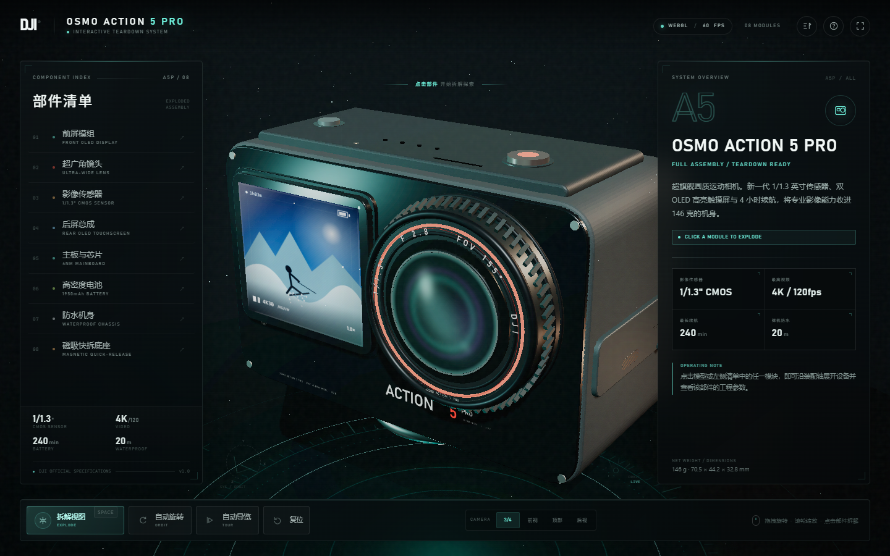

# DJI Osmo Action 5 Pro · 3D 交互拆解

一个无需构建、开箱即用的 Three.js 交互式产品拆解页面。DJI Osmo Action 5 Pro 的机身、镜头、前屏、后屏、传感器、主板、电池、磁吸底座等全部由代码程序化生成，不加载任何外部 3D 模型或贴图。



---

## 快速开始

**方式一：直接打开**

双击 `index.html`，用 Chrome / Edge / Firefox 等支持 WebGL 的现代浏览器打开即可。页面使用的都是本地脚本，`file://` 协议下也能运行。

**方式二：本地静态服务器（推荐）**

```bash
cd dji-action5-pro
python -m http.server 8000
```

浏览器访问 <http://127.0.0.1:8000>。

> 不需要 Node.js、npm 或任何构建步骤。

---

## 交互操作

| 操作 | 效果 |
| --- | --- |
| 鼠标左键拖拽 / 触屏单指滑动 | 旋转观察视角 |
| 滚轮 / 双指捏合 | 缩放 |
| 点击 3D 模型上的部件 | 展开拆解视图、聚焦高亮、加载参数 |
| 点击左侧清单 / 场景中的标注 | 选择对应部件 |
| `空格` / 底部「拆解视图」 | 拆解或复原全部部件 |
| `1`–`8` | 快速选择 1–8 号部件 |
| `R` / 底部「复位」 | 复位视角、装配状态与标注 |
| `L` | 显示 / 隐藏部件标注 |
| `H` | 打开操作指南 |
| `F` | 全屏 |
| `Esc` | 关闭帮助 / 取消当前选中 |
| 双击空白处 | 复位视角 |

底部工具条还提供：

- **自动旋转**：以缓慢速度环绕产品，适合展示。
- **自动导览**：每 5.6 秒自动切换一个部件并更新详情，可随时停止。
- **视角切换**：3/4、前视、顶部、后视。

移动端会自动切换为底部操作坞，部件清单与参数详情以抽屉 / 底部面板呈现。

---

## 功能特性

- **程序化外观还原**
  - 7.02 × 4.38 × 3.08 代码单位比例的圆角机身。
  - 155° 超广角镜组，含多层镜筒、红色饰环、环形铭文与自定义玻璃反射 Shader。
  - 前后双 OLED 屏，屏幕 UI 由 Canvas 实时绘制。
  - 顶部快门、麦克风孔、侧盖 USB-C / microSD 标识、底部磁吸快拆结构等细节。

- **组件级拆解**
  - 8 个独立可点击部件：前屏、镜头、传感器、后屏、主板与芯片、电池、防水机身、磁吸底座。
  - 每个部件拥有独立的拆解位移、旋转姿态与错峰阻尼动画。
  - 选中部件会获得发光环、包围线框、材质自发光与强调标注。

- **实时标注系统**
  - 每帧把 3D 部件的锚点投影到屏幕，绘制虚线引导线和名称 / 参数标签。
  - 双侧标签碰撞分离，自动避让左右面板与视口边缘。
  - 选中或聚焦某个部件时，自动收拢无关标注。

- **工程参数面板**
  - 右侧详情面板包含部件编号、名称、英文名、功能描述、4 项核心参数、工程说明与材质 / 结构信息。
  - 初始状态为整机概览，随时可按 `R` 返回。
  - 支持「定位部件」将镜头拉近至所选模块。

- **科技视觉系统**
  - 深色径向渐变背景、扫描线、噪点、网格、粒子与旋转地面技术环。
  - UnrealBloomPass 泛光、ACES 色调映射、程序化立方体环境反射、软阴影。
  - SVG / DOM 混合标注、玻璃拟态面板、响应式布局与键盘可访问性。

- **性能与兼容**
  - 桌面端最大 DPR 2.0，移动端限制 1.6；移动端自动降低泛光强度。
  - 自动识别窄屏并重新适配相机距离。
  - 尊重系统 `prefers-reduced-motion` 设置。
  - WebGL 不可用时显示友好的降级提示。

---

## 项目结构

```text
dji-action5-pro/
├── index.html                 # 页面结构、字体与 UI
├── css/
│   └── style.css              # 完整视觉系统、响应式与动效
├── js/
│   └── main.js                # 3D 模型、交互、标注、动画与 UI 逻辑
├── vendor/
│   ├── three.min.js           # Three.js r128 (MIT)
│   ├── postprocessing/        # EffectComposer / RenderPass / UnrealBloomPass
│   └── shaders/               # CopyShader / LuminosityHighPassShader
├── preview.png                # 桌面端预览
├── preview-exploded.png       # 拆解视图预览
└── README.md
```

**外部依赖：** 仅 Three.js r128 及其官方后期处理模块，已全部本地化，无 CDN / 网络请求。

---

## 技术说明

- **几何生成**：使用 `Shape + ExtrudeGeometry` 构建圆角机身和面板，使用 `CylinderGeometry / TorusGeometry / BoxGeometry` 拼装镜头、磁吸底座、按键及内部元件。
- **纹理生成**：所有屏幕 UI、镜头铭文、PCB 走线、电池标签与噪点均由 Canvas 2D 在运行时绘制为 `CanvasTexture`。
- **自定义轨道相机**：实现带阻尼的球坐标环绕、自动旋转、惯性视角切换与双击复位。
- **Raycaster 拾取**：对已注册的可交互网格进行拾取，整体拆解和单件聚焦由两套偏移量叠加。
- **对象标注**：通过投影矩阵和屏幕空间碰撞布局保持标签可读。
- **后期处理**：本地 Three.js r128 EffectComposer + UnrealBloomPass，对高亮屏幕、红色镜头环和选中发光层做泛光。

---

## 数据来源与声明

产品参数整理自 DJI Osmo Action 5 Pro 官方技术参数页，用于交互展示中的信息注解。

> 本页面是基于公开资料制作的概念性交互可视化，并非 DJI 官方产品模型或官方页面。几何结构、内部布局和材质表现为视觉重建，不完全等同于真实产品 CAD；规格数据以 DJI 官方发布信息为准。

Three.js 采用 MIT License，版权归 Three.js Authors 所有。
